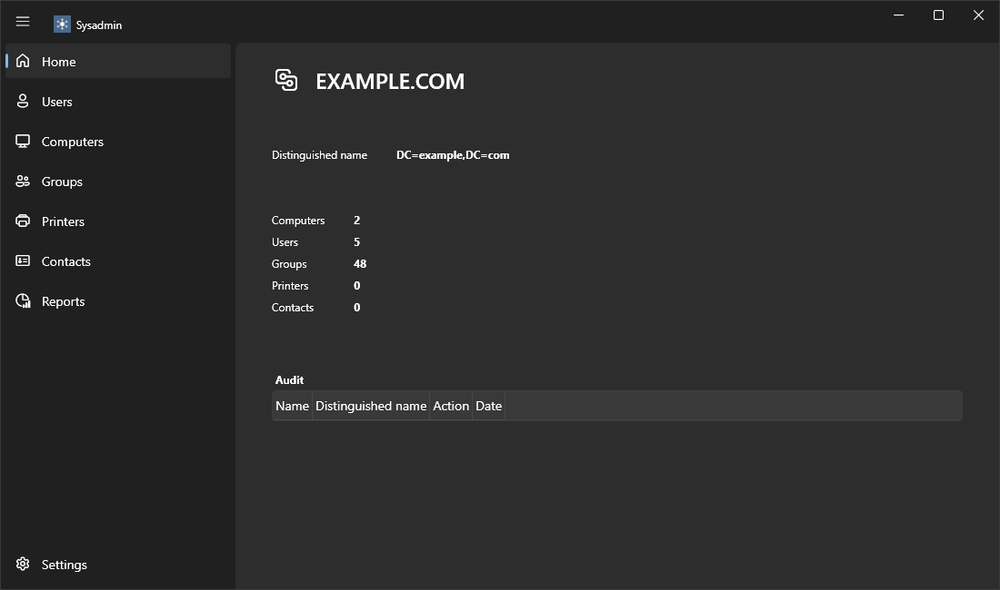

# Sysadmin

**Sysadmin** is a free Windows application that makes administering multi-domain Active Directory-based networks easier. It provides a single tool for managing domains, servers, computers, users, and groups — without switching between MMC snap-ins and a dozen utilities.

[](https://github.com/sysadminanywhere/sysadmin/releases/latest)
[](https://github.com/sysadminanywhere/sysadmin/actions/workflows/codacy.yml)
[](https://github.com/sysadminanywhere/sysadmin/actions/workflows/devskim.yml)



## Features

### Users
- Create, edit, and delete user accounts
- Reset a user's password
- Manage account options: cannot change password, password never expires, account disabled, must change password at next logon
- Upload and remove photos (`jpegPhoto` and `thumbnailPhoto`)
- View and change group membership
- Search, sort, and filter: all, enabled, disabled, locked out, password expired, password never expires

### Computers
- Create, edit, and delete computer objects
- View and change group membership
- Manage remote computers via WMI:
  - event log with filters
  - services — start and stop
  - processes — terminate
  - installed software
  - hardware: CPU, memory, disks, video controller, baseboard, BIOS, and more
  - performance: CPU, memory, and disk usage
- Restart and shut down remote computers
- Connect via VNC and RDP

### Groups and contacts
- Create, edit, and delete groups
- Manage group members and group membership in other groups
- Create, edit, and delete contacts
- Browse printers

### Reports
24 built-in reports for computers, groups, users, and printers, exportable to PDF:

| Category | Reports |
|----------|---------|
| Computers | all computers, domain controllers, disabled computers, servers, created dates, last logon |
| Groups | all groups, domain security groups, global distribution groups, global security groups, universal security groups, created dates |
| Users | all users, must change password at next logon, disabled users, locked out users, password never expires, created dates, logon scripts, profile paths, home folders, last logon, users without manager |
| Others | printers |

### Additional
- Two connection modes: current Windows credentials or explicit LDAP sign-in (user name, password, port, SSL)
- Patterns for display names and logon names of new users
- Default password for new accounts
- Light and dark themes
- Automatic updates via AutoUpdater.NET

## Requirements

- Windows 10 or Windows 11 (x64)
- .NET 8 Desktop Runtime — for framework-dependent builds (the installer includes everything needed)
- An account with permissions to read and modify Active Directory objects
- For remote computer management: WMI (DCOM/RPC) access and local administrator rights on target machines
- LDAP port `389` (or `636` when using SSL)

## Download

Download the latest installer from the [Releases](https://github.com/sysadminanywhere/sysadmin/releases) page and run `SysadminSetup.exe`.

## Connecting to Active Directory

The login screen offers two modes:

1. **Current Windows credentials** — the application uses the account you are signed in with. You can also specify alternative credentials.
2. **LDAP server** — enter the server name, port (`389` or `636`), SSL option, user name, and password.

After a successful connection, the application discovers the domain containers and opens the dashboard. Connection settings (except the password) are saved between launches.

## Settings

The settings file is located at `%APPDATA%\Sysadmin Anywhere\Sysadmin\settings.json`.

Under **Settings** you can change:

- the theme (light/dark);
- the display name pattern (`First Last`, `Last First`, etc.);
- the user logon name pattern (`FLast`, `F.Last`, `First.Last`, `Last`, `LastF`);
- the default password for new users;
- the VNC viewer path and VNC port.

## Building from source

You need the [.NET 8 SDK](https://dotnet.microsoft.com/download/dotnet/8.0) and Windows.

```powershell
dotnet build src\Sysadmin\Sysadmin.csproj -c Release
```

You can also open `src\Sysadmin.sln` in Visual Studio. The installer is built with [Inno Setup](https://jrsoftware.org/isinfo.php) using the script at `src\Setup\SysAdmin.iss`.

## Contributing

Bug reports and feature suggestions are welcome — please use the [issue templates](https://github.com/sysadminanywhere/sysadmin/issues/new/choose). Pull requests are welcome too.

## License

This software is distributed under the terms of the MIT License (MIT). See [LICENSE](LICENSE) for details.

## Author

Igor Markin / [LinkedIn](https://www.linkedin.com/in/igor-markin/)

Website: [sysadminanywhere.com](https://sysadminanywhere.com)
